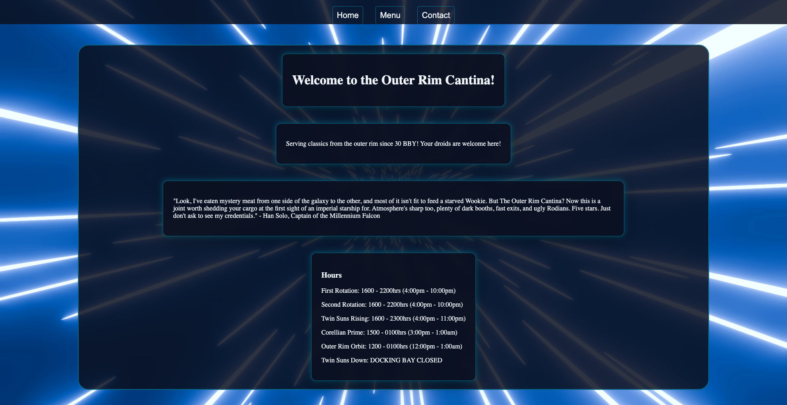
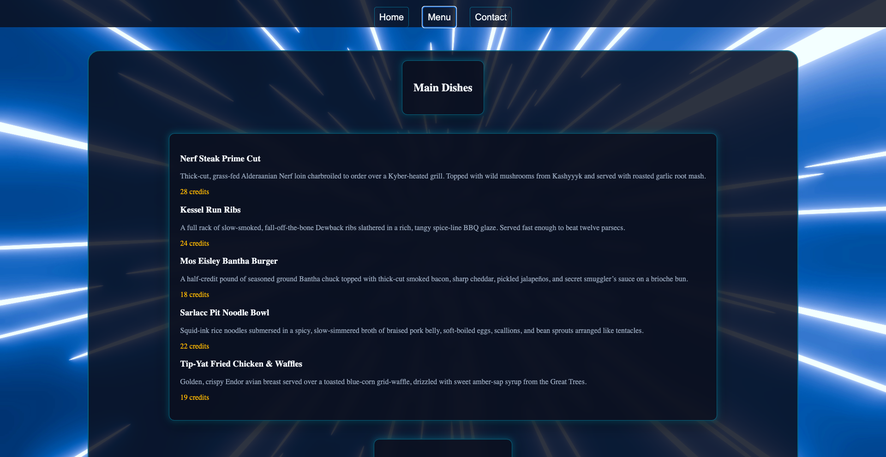
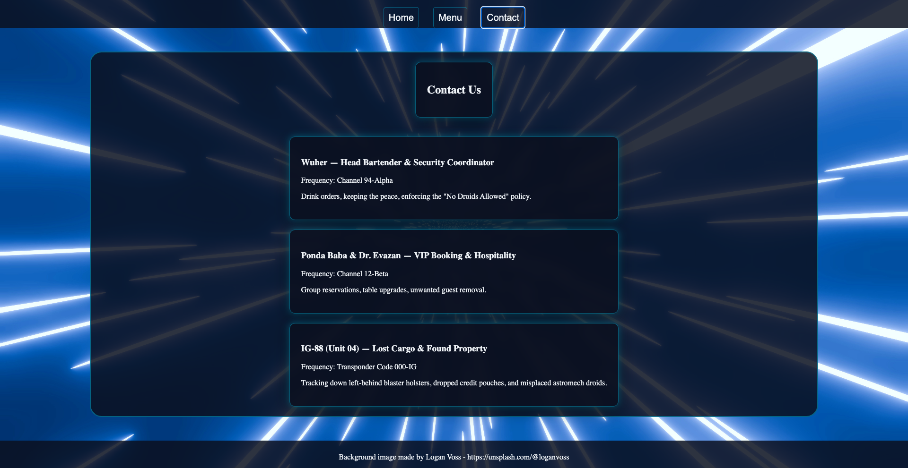

# Odin Restaurant Page
A multi-section restaurant website built with JavaScript modules and Webpack for The Odin Project's Full Stack JavaScript curriculum.

**Live Demo: https://anthonyc20b.github.io/odin-restaurant-page/** 

---
## Screenshot




---
## Features
- Each page section is built in its own JavaScript module and rendered entirely through the DOM
- Custom tab switching between sections without reloading the page
- Webpack bundles the modules into a single output
- Semi-responsive layout that works on both mobile and desktop
- Syled with a space theme using CSS variables, glassmorphism effects, and flexbox layout

---
## Built With
- HTML5
- CSS3
- JavaScript (Vanilla, ES modules)
- Webpack

---
## What I Learned
This project was about understanding how JavaScript modules and Webpack fit together. Splitting each section of the page into its own module meant every file could follow a similar structure without naming collisions or errors from files stepping on each other. Webpack then bundles everything into one output, which made the value of a build tool clear in a way reading about it hadn't.

The biggest shift was planning the layout before writing any code. Since every element is created with the DOM, I had to decide up front what the HTML should look like. For example, which divs, classes, and IDs each section needed. Mapping that out first made the modules cleaner and kept the custom tab switching simple, because each section was already built to be swapped in and out. That also made everything very modular and workable.

---
## Running locally
Clone the repo, install dependencies, and build with Webpack:
```bash
git clone git@github.com:anthonyc20b/odin-restaurant-page.git
cd odin-restaurant-page
npm install
npx webpack
```
Then open `dist/index.html` in a browser.